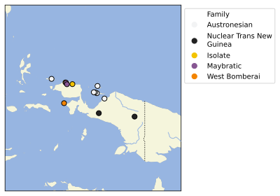

# Papuan Voices

## How to cite

If you use these data please cite
- the original source
  > Yusuf Sawaki, Jeanete Lekeneny, Apriani Arilaha, Jimmi Kirihio, Emanuel Tutorop, Boas Wabia, Infak Mayor, Simon Tabuni, Stevani Karesina, Paul Heggarty, Darja Dërmaku-Appelganz (2020). Papuan Voices.
- the derived dataset using the DOI of the [particular released version](../../releases/) you were using

## Description

Papuan Voices presents phonetically-transcribed primary recordings, from numerous places throughout Papua island

This dataset is licensed under a CC-BY-NC-4.0 license

Available online at https://papuanvoices.clld.org

## Notes

## Statistics

- **Varieties:** 13 (linked to 13 different Glottocodes)
- **Concepts:** 215 (linked to 215 different Concepticon concept sets)
- **Lexemes:** 2,771
- **Sources:** 1
- **Synonymy:** 1.00
- **Invalid lexemes:** 10
- **Tokens:** 13,627
- **Segments:** 60 (0 BIPA errors, 0 CLTS sound class errors, 61 CLTS modified)
- **Inventory size (avg):** 26.62

# Contributors

Name               | GitHub user | Description                  | Role
---                |----| ---                                  | ---
Yusuf Sawaki |    | admin, data entry | Author
Jeanete Lekeneny |    | data entry, audio recordings | Author
Apriani Arilaha |    | data entry, audio recordings | Author
Jimmi Kirihio |    | data entry, audio recordings | Author
Emanuel Tutorop |    | data entry, audio recordings | Author
Boas Wabia |    | data entry, audio recordings | Author
Infak Mayor |    | data entry | Author
Simon Tabuni |    | data entry | Author
Stevani Karesina |    | data entry | Author
Paul Heggarty |    | author, consultant | Author
Darja Dërmaku-Appelganz |    | audio post-processing | Author
Russell Gray |    | Director of the Department of Linguistic and Cultural Evolution, which fully supported data collection and processing for the Papuan Voices study. | Author
Hans-Jörg Bibiko |    | patron, maintainer | Other
Robert Forkel | @xrotwang | maintainer | DataCurator

## CLDF Datasets

The following CLDF datasets are available in [cldf](cldf):

- CLDF [Wordlist](https://github.com/cldf/cldf/tree/master/modules/Wordlist) at [cldf/cldf-metadata.json](cldf/cldf-metadata.json)